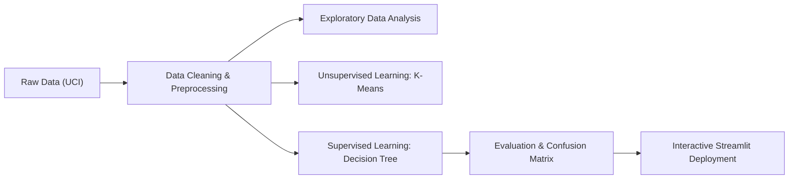

# Student Performance Analysis and Prediction System Using Data Mining

[](https://www.python.org/)
[](https://scikit-learn.org/)
[](https://streamlit.io/)
[](#)

A complete, beginner-friendly, and fully functional Data Mining engineering project designed for academic evaluation and viva presentations. The system analyzes secondary school student academic data, performs exploratory analysis, discovers natural student cohorts using unsupervised **K-Means Clustering**, and predicts student final exam outcomes (**Pass/Fail**) using an interpretable **Decision Tree Classifier** based on **Information Gain (Entropy)**.

Featuring a sleek **cyber-academic dark theme** with snappy micro-animations, a black sidebar with high-contrast typography, and a **Dynamic Custom CSV Upload Engine** allowing users to upload and evaluate their own datasets on the fly.

---

## Table of Contents
1. [Project Overview](#1-project-overview)
2. [Problem Statement](#2-problem-statement)
3. [Project Objectives](#3-project-objectives)
4. [Dataset Description & Download](#4-dataset-description--download)
5. [Data Mining Syllabus Connections](#5-data-mining-syllabus-connections)
6. [Algorithms & Core Concepts](#6-algorithms--core-concepts)
7. [System Architecture & Implementation](#7-system-architecture--implementation)
8. [Folder Structure](#8-folder-structure)
9. [Installation & Setup](#9-installation--setup)
10. [Execution Guide](#10-execution-guide)
11. [Expected Outputs & Evaluation Results](#11-expected-outputs--evaluation-results)
12. [How to Present This Project in an Academic Viva](#12-how-to-present-this-project-in-an-academic-viva)
13. [Limitations & Future Enhancements](#13-limitations--future-enhancements)

---

## 1. Project Overview

Academic institutions often face challenges in identifying students who need additional scholastic support before final examinations occur. This project develops a data-driven **Student Performance Analysis and Prediction System** using data mining and machine learning principles.

The application ingests historical student demographic, lifestyle, and preliminary examination data to:
- Dissect behavioral trends that correlate with academic success or failure.
- Group students into meaningful academic cohorts (High Achievers, Average, At-Risk) without relying on target labels.
- Forecast whether an individual student will **Pass** ($G3 \ge 10$) or **Fail** ($G3 < 10$) early enough to allow for targeted educational interventions.

---

## 2. Problem Statement

Final examinations determine a student's educational trajectory, yet final assessments come too late for remedial actions. If educators only observe final grades ($G3$), intervention is impossible. 

**Core Question:** Can we leverage data mining techniques on early diagnostic examinations ($G1$, $G2$) and non-academic behavioral factors (study time, past failures, absences, family support) to accurately predict final pass/fail outcomes while strictly avoiding data leakage?

---

## 3. Project Objectives

1. **Perform Exploratory Data Analysis (EDA):** Identify statistical relationships, distributions, and correlations between student attributes and final academic performance.
2. **Apply Rigorous Data Preprocessing:** Clean records, impute missing values using Scikit-Learn imputers, encode categorical features, and formulate a binary classification target.
3. **Prevent Target Leakage:** Strictly exclude final exam score $G3$ from predictive input features.
4. **Implement Unsupervised Clustering:** Utilize **K-Means** with the **Elbow Method** to segment students into data-driven clusters and interpret each cluster objectively based on empirical characteristics.
5. **Implement Supervised Classification:** Train an interpretable **Decision Tree Classifier** using **Information Gain (Entropy)** on an 80:20 stratified split.
6. **Evaluate Model Performance:** Measure real empirical Accuracy, Precision, Recall, F1-Score, and visualize the Confusion Matrix and Decision Tree topology.
7. **Deliver an Interactive Web Application:** Provide an intuitive Streamlit dashboard for real-time visualization and single-student inference.

---

## 4. Dataset Description & Download

### Dataset Source
- **Origin:** UCI Machine Learning Repository
- **Official URL:** [UCI Student Performance Dataset](https://archive.ics.uci.edu/dataset/320/student+performance)
- **Publication Reference:** P. Cortez and A. Silva. *Using Data Mining to Predict Secondary School Student Performance*. EUROSIS, 2008.
- **Specific File Used:** `student-mat.csv` (Mathematics Course Dataset).

### Key Characteristics
- **Format:** CSV with semicolon (`;`) delimiters.
- **Instances:** 395 student records.
- **Total Attributes:** 33 original features.
- **Grading Scale:** 0 to 20 points (standard Portuguese secondary grading system).

### Target Variable Formulation
- **Original Target:** $G3 \in [0, 20]$ (final year grade).
- **Binary Target (`passed`):**
  - **Pass ($1$):** $G3 \ge 10$ (265 students, 67.1%)
  - **Fail ($0$):** $G3 < 10$ (130 students, 32.9%)

### Features Used in Classification
| Feature | Type | Description | Values / Scale |
| :--- | :--- | :--- | :--- |
| `G1` | Numeric | 1st period examination grade | 0 to 20 |
| `G2` | Numeric | 2nd period examination grade | 0 to 20 |
| `failures` | Numeric | Number of past class failures | 0, 1, 2, 3 |
| `studytime` | Numeric | Weekly study hours tier | 1 (<2h), 2 (2-5h), 3 (5-10h), 4 (>10h) |
| `absences` | Numeric | Total school absences | 0 to 93 days |
| `age` | Numeric | Student age | 15 to 22 |
| `sex` | Categorical | Student gender | `'F'` (Female), `'M'` (Male) |
| `address` | Categorical | Home address zone | `'U'` (Urban), `'R'` (Rural) |
| `schoolsup` | Categorical | Extra educational school support | `'yes'`, `'no'` |
| `famsup` | Categorical | Family educational support | `'yes'`, `'no'` |
| `paid` | Categorical | Extra paid classes within the course | `'yes'`, `'no'` |
| `activities` | Categorical | Extracurricular activities participation | `'yes'`, `'no'` |
| `higher` | Categorical | Aspirations for higher education | `'yes'`, `'no'` |
| `internet` | Categorical | Internet access at home | `'yes'`, `'no'` |

> ⚠️ **Critical Data Mining Rule:** Final examination grade **G3 is NEVER used as an input feature** during model training. Including G3 would cause **Target Leakage**, artificially inflating accuracy to 100% while rendering the model useless for practical early prediction.

### Automatic Dataset Setup
The project automatically locates and verifies `data/student-mat.csv`. If you clone this repository to a fresh machine without the dataset, simply place `student-mat.csv` inside the `data/` folder.

---

## 5. Data Mining Syllabus Connections

This mini-project directly maps to standard university Data Mining course syllabi:



1. **CRISP-DM Methodology:** Follows the standard Cross-Industry Standard Process for Data Mining (Business Understanding $\rightarrow$ Data Understanding $\rightarrow$ Data Preparation $\rightarrow$ Modeling $\rightarrow$ Evaluation $\rightarrow$ Deployment).
2. **Data Transformation & Cleaning:** Imputation of missing records using `SimpleImputer`, categorical handling via `OneHotEncoder`, and feature scaling with `StandardScaler`.
3. **Unsupervised vs. Supervised Paradigms:**
   - **Clustering:** Discovers hidden behavioral groupings without teacher signals.
   - **Classification:** Maps multidimensional student attributes to a discrete class label ($Pass / Fail$).
4. **Information Theory:** Calculation of Entropy and Information Gain for Decision Tree splits.
5. **Empirical Model Validation:** Stratified holdout validation, Confusion Matrix analysis, and harmonic metric synthesis ($F_1$-score).

---

## 6. Algorithms & Core Concepts

### 1. K-Means Clustering (Unsupervised Learning)
K-Means partitions $n$ students into $k$ distinct, non-overlapping clusters:
$$\min \sum_{j=1}^{k} \sum_{x_i \in C_j} \|x_i - \mu_j\|^2$$
- **Step 1:** Numerical attributes (`studytime`, `failures`, `absences`, `G1`, `G2`) are standardized using `StandardScaler` so that features with large numerical ranges (e.g., absences up to 93) do not distort Euclidean distance calculations.
- **Step 2 (The Elbow Method):** We calculate the Within-Cluster Sum of Squares (Inertia/WCSS) for $k \in [1, 8]$. The "elbow point" at $k=3$ marks the optimal trade-off between compactness and complexity.
- **Step 3 (Dynamic Interpretation):** Clusters are not given hardcoded roles. The algorithm computes average final grades for each cluster and assigns dynamic labels:
  - **High Academic Achievers:** High mean G1/G2/G3, near-zero past failures.
  - **Moderate / Average Performers:** Moderate passing grades near class mean, moderate study habits.
  - **At-Risk / Needs Support:** Low exam scores, high past failures ($>2$), elevated absences.

### 2. Decision Tree Classifier (Supervised Learning)
A Decision Tree recursively partitions the training dataset based on the feature that provides the greatest reduction in uncertainty (**Entropy**).
- **Entropy Formula:**
  $$\text{Entropy}(S) = - \sum_{i=1}^{c} p_i \log_2(p_i)$$
  Where $p_i$ is the probability of class $i$ (Pass or Fail) in subset $S$.
- **Information Gain Formula:**
  $$\text{Gain}(S, A) = \text{Entropy}(S) - \sum_{v \in \text{Values}(A)} \frac{|S_v|}{|S|} \text{Entropy}(S_v)$$
  The algorithm selects the split with maximum Information Gain at each internal decision node.
- **Tree Constraints:** We configure `max_depth=4` and `min_samples_leaf=5` to prevent overfitting on 316 training samples and ensure the tree remains human-readable for viva examination.

### 3. Model Evaluation Metrics
- **Accuracy:** $\frac{TP + TN}{TP + TN + FP + FN}$ (Overall proportion of correct predictions).
- **Precision (Positive Class = Pass):** $\frac{TP}{TP + FP}$ (Fraction of predicted Passes that actually passed; guarantees minimal false alarms).
- **Recall (Sensitivity):** $\frac{TP}{TP + FN}$ (Fraction of actual passing students correctly identified).
- **F1-Score:** $2 \times \frac{\text{Precision} \times \text{Recall}}{\text{Precision} + \text{Recall}}$ (Harmonic mean balancing Precision and Recall).

---

## 7. System Architecture & Implementation

```
Student Performance System Architecture
│
├── Input Layer: Raw Student Records (CSV)
│
├── Preprocessing Pipeline (Scikit-Learn ColumnTransformer)
│   ├── SimpleImputer (median for numeric, most frequent for categorical)
│   ├── OneHotEncoder (handle_unknown='ignore')
│   └── Target Discretization (G3 >= 10 -> Pass)
│
├── Analytical Engines
│   ├── Unsupervised Engine: StandardScaler -> KMeans(k=3) -> Cluster Profiling
│   └── Supervised Engine: Pipeline(Preprocessor -> DecisionTreeClassifier(entropy))
│
├── Persistence & Artifacts Layer
│   ├── models/trained_model.pkl (Joblib pipeline)
│   ├── outputs/graphs/ (High-resolution 300 DPI visualizations)
│   └── outputs/reports/ (model_evaluation_report.txt)
│
└── Presentation Layer
    ├── Interactive Streamlit Application (app.py)
    └── Exploratory Jupyter Notebook (notebooks/student_performance_analysis.ipynb)
```

---

## 8. Folder Structure

```
student-performance-analysis/
│
├── app.py                     # Interactive Streamlit Web Dashboard (Dark Theme)
├── run_all_pipeline.py        # Master pipeline execution script
├── requirements.txt           # Python dependency specifications
├── README.md                  # Comprehensive academic documentation
├── VIVA_QUESTIONS_AND_ANSWERS.md # Viva Voce & Oral Defense Q&A Guide
├── PROJECT_PRESENTATION_SLIDES.md# 12-slide seminar presentation script
│
├── assets/
│   └── logo.png               # High-resolution local portal emblem
│
├── data/
│   ├── student-mat.csv        # Official UCI Mathematics dataset (395 records)
│   └── sample_custom_students.csv # Pre-bundled custom dataset for upload testing (150 records)
│
├── src/
│   ├── data_preprocessing.py  # Loading, cleaning, imputation, encoding, train-test split
│   ├── exploratory_analysis.py# 7 publication-quality EDA Matplotlib/Seaborn plots
│   ├── clustering.py          # K-Means clustering, Elbow method, dynamic profiling
│   ├── classification.py      # Decision tree pipeline training, serialization, inference
│   └── evaluation.py          # Metrics computation, confusion matrix, tree visualization
│
├── models/
│   └── trained_model.pkl      # Serialized Scikit-learn Pipeline (Joblib)
│
├── outputs/
│   ├── graphs/                # Generated 300 DPI plots
│   │   ├── absences_vs_g3.png
│   │   ├── cluster_distribution.png
│   │   ├── confusion_matrix.png
│   │   ├── correlation_heatmap.png
│   │   ├── elbow_curve.png
│   │   ├── g1_g2_vs_g3.png
│   │   ├── g3_distribution.png
│   │   ├── metrics_comparison.png
│   │   ├── pass_fail_count.png
│   │   ├── studytime_performance_comparison.png
│   │   ├── studytime_vs_g3.png
│   │   └── tree_visualization.png
│   └── reports/
│       └── model_evaluation_report.txt  # Detailed text evaluation report
│
└── notebooks/
    └── student_performance_analysis.ipynb  # Step-by-step Jupyter Notebook
```

---

## 9. Installation & Setup

### ⚡ 1-Click Launch (Windows - No CLI Required)
Simply double-click:
- **`run_dashboard.bat`**: Automatically checks Python, installs missing dependencies, and opens the interactive dashboard at `http://localhost:8501`.
- **`run_pipeline.bat`**: Executes the master ML pipeline, regenerating all graphs and evaluation reports.

---

### Manual Setup via Terminal

### Prerequisites
- Python 3.10 or higher installed on your operating system.
- Git (optional, for version control).

### Step 1: Clone or Open the Project
Open a terminal in the project directory:
```bash
cd "c:\Users\avane\OneDrive\Desktop\College\Mining\Project"
```

### Step 2: Create a Virtual Environment (Recommended)
```bash
python -m venv venv
# On Windows PowerShell:
venv\Scripts\Activate.ps1
# On Linux/macOS:
source venv/bin/activate
```

### Step 3: Install Required Dependencies
```bash
pip install -r requirements.txt
```

---

## 10. Execution Guide

You can run individual modules directly from the command line, or launch the interactive web dashboard.

### 1. Run Data Preprocessing
```bash
python src/data_preprocessing.py
```
*Outputs: Audits missing values, verifies dimensions, prints train/test split distributions.*

### 2. Generate All EDA Plots
```bash
python src/exploratory_analysis.py
```
*Outputs: Generates and exports all 7 graphs to `outputs/graphs/`.*

### 3. Run K-Means Clustering
```bash
python src/clustering.py
```
*Outputs: Computes inertia across $k \in [1, 8]$, saves `elbow_curve.png`, generates `cluster_distribution.png`, and prints dynamic academic profiles.*

### 4. Train Decision Tree & Evaluate
```bash
python src/classification.py
python src/evaluation.py
```
*Outputs: Trains the pipeline, saves `models/trained_model.pkl`, tests on holdout data, creates `confusion_matrix.png`, `tree_visualization.png`, and updates `model_evaluation_report.txt`.*

### 5. Launch the Streamlit Web Dashboard
```bash
python -m streamlit run app.py
```
*(Or `streamlit run app.py` if Streamlit is in your system PATH).*
The application will launch automatically in your browser at `http://localhost:8501`.

### 6. Uploading Custom CSV Datasets
Inside the web dashboard, use the sidebar's **Dataset Configuration**:
1. Select **"📤 Upload Custom CSV File"**.
2. Upload any student dataset (e.g., `data/sample_custom_students.csv` or other school records).
3. The application automatically detects the delimiter (`,`, `;`, `\t`), cleans the records, executes K-Means clustering, and re-trains the Decision Tree classifier dynamically!

---

## 11. Expected Outputs & Evaluation Results

Tested on an 80:20 stratified holdout set ($N_{\text{test}} = 79$ students):

### Model Performance Metrics
| Metric | Value | Meaning |
| :--- | :--- | :--- |
| **Accuracy** | **87.34%** | 69 out of 79 test students correctly classified |
| **Precision (Pass)** | **100.00%** | Zero false passes predicted (no unwarranted optimistic alarms) |
| **Recall (Pass)** | **81.13%** | Correctly identified 43 of 53 passing students |
| **F1-Score (Pass)** | **89.58%** | High harmonic balance between precision and recall |

### Confusion Matrix Breakdown
- **True Negatives (TN):** $26$ students correctly predicted as **Fail**.
- **False Positives (FP):** $0$ students incorrectly predicted as **Pass** (0% False Alarm Rate).
- **False Negatives (FN):** $10$ students predicted as Fail who passed.
- **True Positives (TP):** $43$ students correctly predicted as **Pass**.

### Generated Visualizations (in `outputs/graphs/`)
1. `g3_distribution.png`: Histogram with KDE curve showing final grade dispersion and passing cutoff.
2. `pass_fail_count.png`: Bar chart of pass/fail cohort sizes.
3. `studytime_vs_g3.png`: Box plots showing positive grade shifts with higher weekly study hours.
4. `absences_vs_g3.png`: Scatter plot illustrating the negative impact of high absenteeism.
5. `g1_g2_vs_g3.png`: Dual subplots demonstrating strong correlation ($r \approx 0.90$) between early exams and final grade.
6. `correlation_heatmap.png`: Heatmap across all numerical attributes.
7. `studytime_performance_comparison.png`: Bar comparison across study tiers.
8. `elbow_curve.png`: Inertia curve indicating optimal $k=3$.
9. `cluster_distribution.png`: Scatter plot of clusters with centroids.
10. `confusion_matrix.png`: Annotated 4-quadrant heatmap.
11. `metrics_comparison.png`: Summary bar chart of evaluation metrics.
12. `tree_visualization.png`: Rendered Decision Tree split diagram.

---

## 12. How to Present This Project in an Academic Viva

When demonstrating this project to an evaluator, follow this 4-step walkthrough:

1. **Explain the Motivation & Syllabus Context:**
   - Mention the **CRISP-DM** lifecycle.
   - Highlight **Target Leakage Prevention**: Point out that you consciously omitted $G3$ from inputs and used only diagnostic exams ($G1$, $G2$) and behaviors.
2. **Show the Web Dashboard (Streamlit):**
   - **Home Dashboard:** Highlight the overall dataset metrics (395 students, 67.1% pass rate).
   - **Data Exploration:** Filter the dataset by school or study time, and showcase the correlation heatmap.
   - **Clustering:** Show the Elbow curve at $k=3$ and explain how unsupervised learning grouped students without labels into High Achievers, Average, and At-Risk segments.
3. **Demonstrate Real-Time Prediction:**
   - Go to **Performance Prediction**.
   - Input a student with low grades ($G1=6, G2=7$) and $failures=2$. Click **Predict** $\rightarrow$ Show the **FAIL** prediction with rule explanation.
   - Input a student with solid grades ($G1=14, G2=15$). Click **Predict** $\rightarrow$ Show the **PASS** prediction with $>95\%$ confidence.
4. **Walk Through the Evaluation:**
   - Open **Model Evaluation**.
   - Explain the Confusion Matrix ($TP=43, TN=26, FP=0, FN=10$).
   - Discuss why Precision is 100% (the model never incorrectly predicted that a failing student would pass).
   - Show the Decision Tree visualization and explain how Entropy guided the primary split (at $G2 \ge 9.5$).

---

## 13. Limitations & Future Enhancements

### Limitations
1. **Sample Size:** 395 records from two Portuguese secondary schools. Findings may reflect local regional testing practices.
2. **Feature Coverage:** External psychological, socioeconomic, and teaching-quality factors are not captured in the tabular data.
3. **Binary Target Simplification:** Discretizing continuous grade $G3$ into Pass/Fail loses granular distinctions (e.g., distinguishing between an average pass of 10 and honors of 19).

### Future Enhancements
- **Multi-Class Classification:** Expand prediction into letter grades ($A, B, C, D, F$) or grade tiers (Excellent, Good, Satisfactory, Poor).
- **Regression Modeling:** Implement linear regression, Random Forest Regressors, or Gradient Boosting to predict the exact continuous $G3$ mark ($0 - 20$).
- **Ensemble Techniques:** Benchmark Random Forests and XGBoost against the single Decision Tree to observe variance reduction.
- **Deep Learning Comparison:** Experiment with Tabular Neural Networks (TabNet) for larger student cohorts.

---

## Academic Author & Credits
- **Project:** Student Performance Analysis and Prediction System
- **Subject:** Data Mining Mini-Project
- **Dataset:** UCI Machine Learning Repository (Cortez & Silva, 2008)

